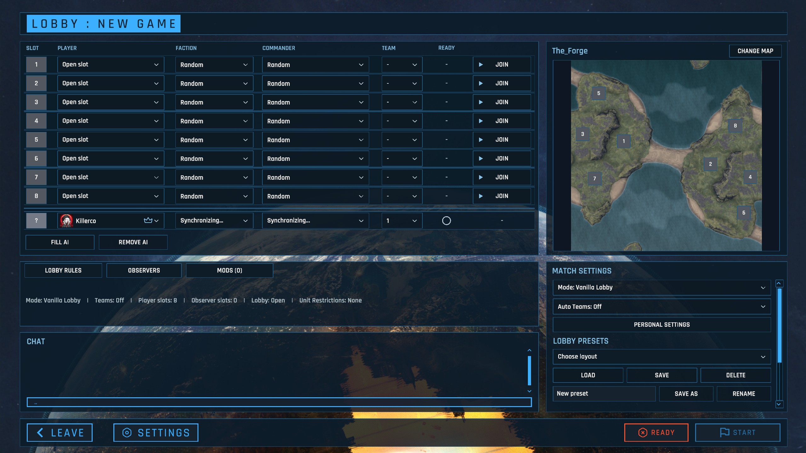
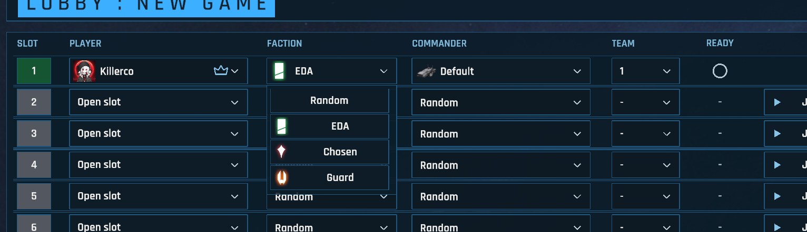
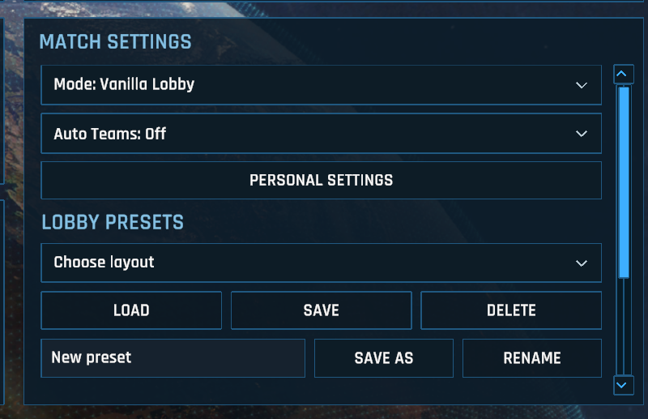
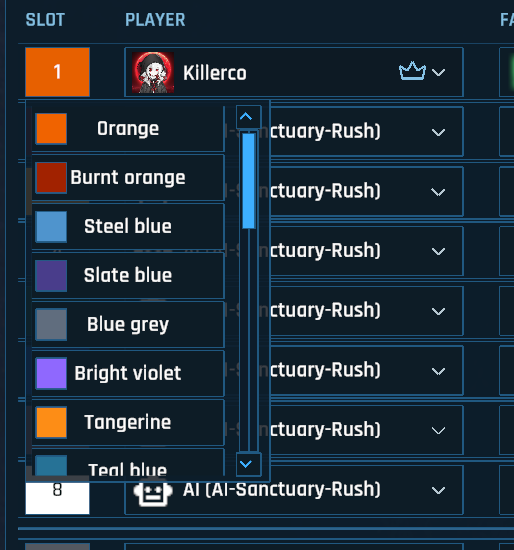
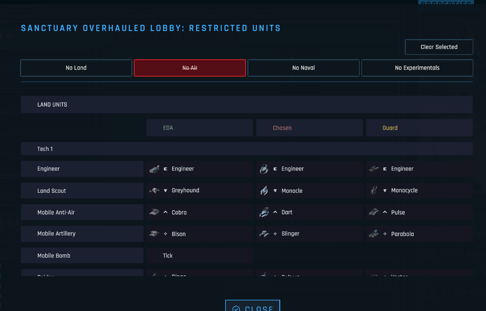

# Sanctuary Overhauled Lobby

A compact multiplayer lobby for **Sanctuary: Shattered Sun** with host tools, presets, and an optional Overhauled mode.

## Download and install

Download the installer ZIP from [Releases](https://github.com/Killercat4444/Sanctuary-Overhauled-Lobby/releases). Extract it, close Sanctuary, then double-click `installer.bat`. Confirm the Playtest folder and approve the install or update. It preserves presets and settings and uses the Windows PowerShell included with Windows.

| Requirement | Supported version |
| --- | --- |
| Sanctuary: Shattered Sun Playtest | 0.0.1.21.1 |
| Remmy’s Mod Manager | 0.17.0 |

## Features

- **Vanilla mode** includes the compact lobby, presets, and host tools with stock lobby rules.
- **Overhauled mode** adds independent player colors and expanded commander controls. All players need the matching build to start an Overhauled match.
- **Host controls** let you move or swap players, assign teams, kick players, and fill open slots with AI or remove AI in bulk.
- **Lobby presets** let you save, rename, update, and reuse setups.
- **Unit restrictions** let you block land, air, naval, or experimental units, or select individual units. Enabled restrictions require the synchronized gameplay component.

## Known limitations

- **Modded maps:** Player-position markers may appear in the wrong places on the map preview. Auto Teams does not work on modded maps.
- **Player limit:** v1.2.0 supports up to eight players. Support for larger lobbies is planned for a future release.

## Screenshots

**Lobby overview** · Player slots, map preview, host controls, and match settings.

**Faction selection** · The faction picker sits beside the separate commander column.

| Match settings and lobby presets | Player color picker |
| --- | --- |
|  |  |

**Unit restrictions** · Category toggles and a list of individual units grouped by faction and tech tier.

## Credits

The Unit Restrictions manager is a modified version of [Remmyboy’s Unit Restrictions mod](https://github.com/Remmyboy/sanctuary-mods).

## Report an issue

Open an [issue](https://github.com/Killercat4444/Sanctuary-Overhauled-Lobby/issues/new) and include your Sanctuary, Mod Manager, and lobby versions, the lobby mode, and steps to reproduce. Remove personal information from any logs or screenshots before posting.

## Build and contribute

The C# plugin is in [src](src/), and the mod manifest and Lua hooks are in [package](package/SanctuaryOverhauledLobby/). See [CONTRIBUTING.md](CONTRIBUTING.md) for build instructions and [CHANGELOG.md](CHANGELOG.md) for version history.

The mod source is available under the [MIT license](LICENSE). Game and dependency binaries are supplied by your local Playtest installation.
